# Halil İbrahim Yılmaz | Portfolio

Portfolio of **Halil İbrahim Yılmaz**, gameplay and systems programmer (Unreal Engine 4 and 5, C++, multiplayer, local AI), based in İzmir, Türkiye. Worked on *SpaceBourne 2* and *Illegal Mechanic Simulator* at game studios, runs a released, actively played full stack *MMORPG M2 Server* and operates local AI systems end to end. Works on-site in İzmir or remotely with teams worldwide. Languages: Turkish (native), English (B1+), German (A1).

**Live site:** https://yilmazhalilibr.github.io/WebSite/

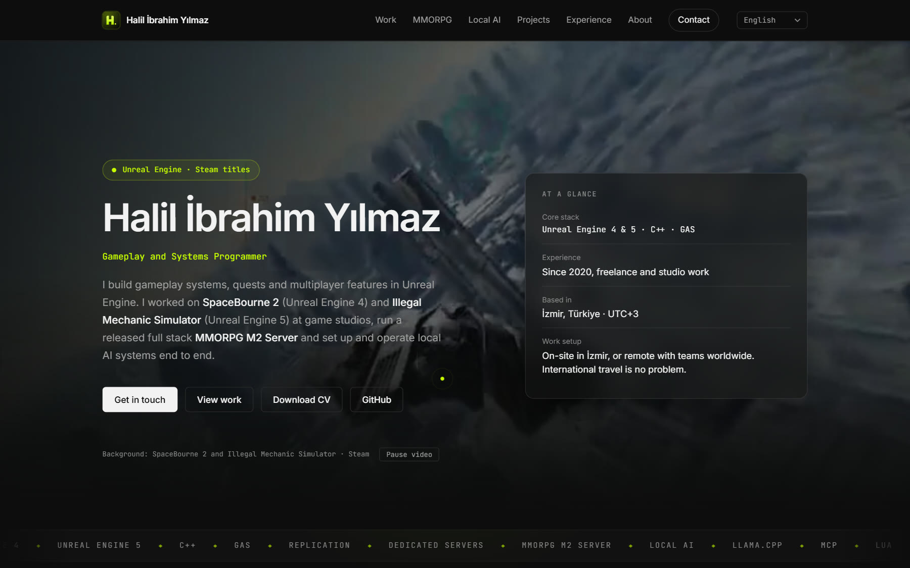

A static site in plain HTML, CSS and one vanilla JavaScript file. No build step, no framework, no tracking, no cookies.

- [What the site does](#what-the-site-does)
- [Screenshots](#screenshots)
- [CV (ATS friendly)](#cv-ats-friendly)
- [Work shown on the site](#work-shown-on-the-site)
- [Languages](#languages)
- [Project structure](#project-structure)
- [Run locally](#run-locally)
- [Customising](#customising)
- [Performance, accessibility, privacy](#performance-accessibility-privacy)
- [Credits and rights](#credits-and-rights)

## What the site does

- **Opens in the visitor's language.** Resolution order: `?lang=` link, saved choice, browser language, English. The dictionary is loaded before first paint, so the page never flashes in English first.
- **Shows the work first.** Order: summary, reasons to work together, studio work, the flagship MMORPG M2 Server (released, active players, test links on request), the local AI workstation, personal projects, experience from 2020, full technology stack, about, contact.
- **Feels like an app on phones.** Below 720 px a floating bottom tab bar (Home, Work, MMORPG, Experience, Contact) follows the scroll position, respects safe areas and gives a light haptic tick where supported.
- **Makes contact easy.** Email, LinkedIn, GitHub and CV cards, plus a message composer that opens the visitor's own email app or Gmail with the message prepared. Nothing is sent to or stored on the site.
- **Looks sharp on large screens.** The hero background plays the SpaceBourne 2 trailer, then the Illegal Mechanic Simulator teaser, then shuffled screenshots, then the trailers again. Trailers are served in 1080p (the highest Steam provides) with a lighter 960 px version for small screens. Stills have a 4K tier (AI upscaled with Real-ESRGAN from the 1080p originals) used when the screen has 2300 or more physical pixels. Custom cursor with spotlight, hero parallax, staggered intro, magnetic buttons, card tilt and reveal on scroll. Everything is disabled for *reduced motion*, and the cursor and tilt only run with a mouse.
- **Own icon.** An "H." monogram (SVG plus PNG, ICO, Apple touch icon and web app manifest with a maskable icon), also used as the header mark.
- **SEO.** Per language title and description, Open Graph and Twitter tags, canonical URL and `schema.org/Person` JSON-LD.

## Screenshots

| Reasons to work together | Studio work |
| --- | --- |
| 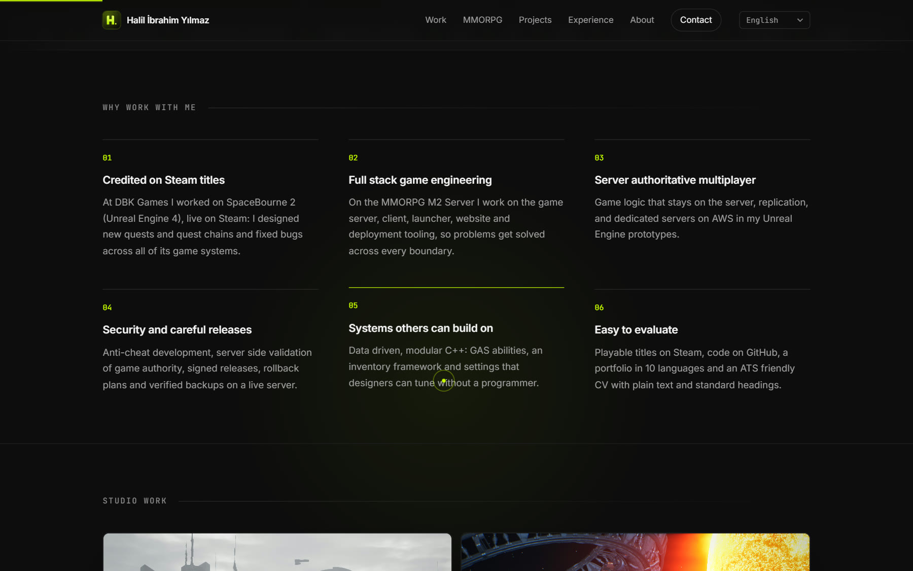 | 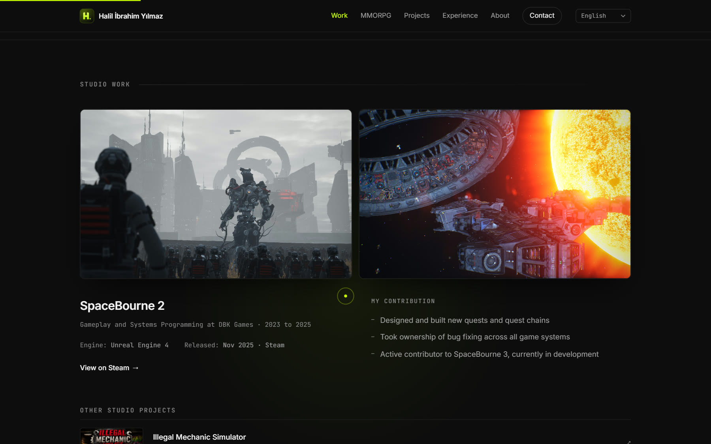 |

| Flagship project | Contact |
| --- | --- |
| 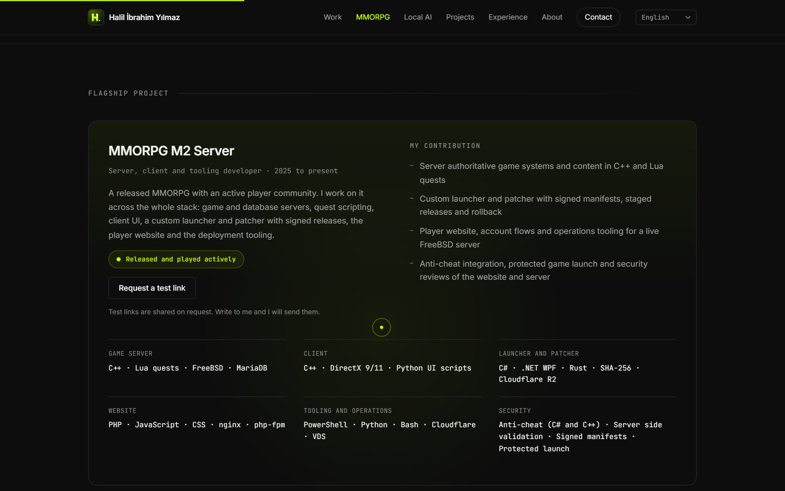 | 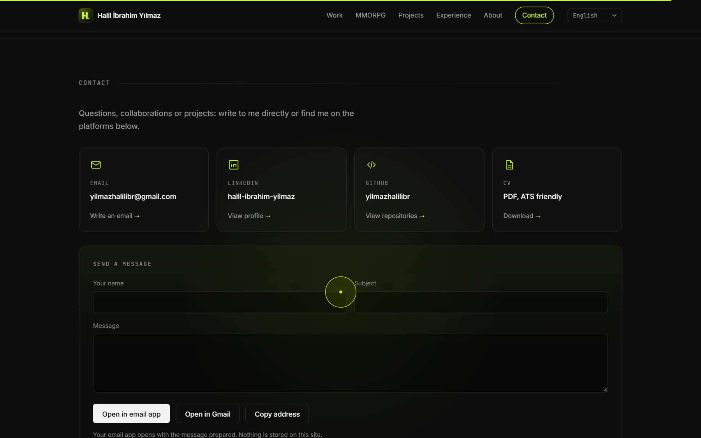 |

Local AI workstation:

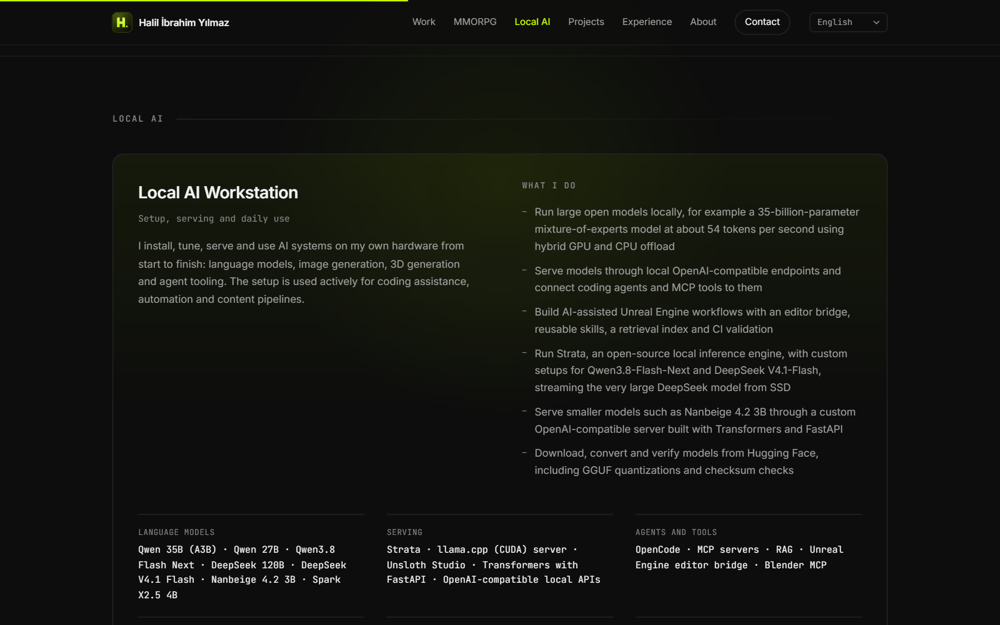

Personal projects:

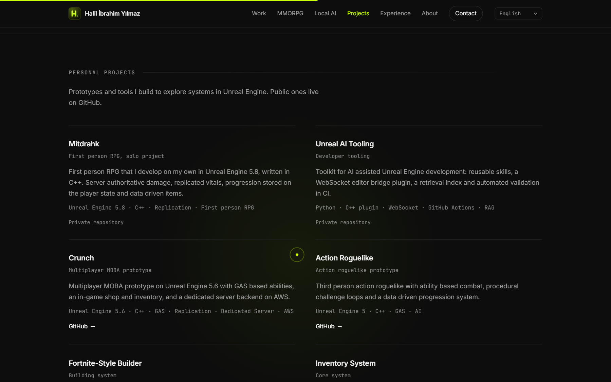

Mobile layout with the bottom tab bar:

<p align="center">
  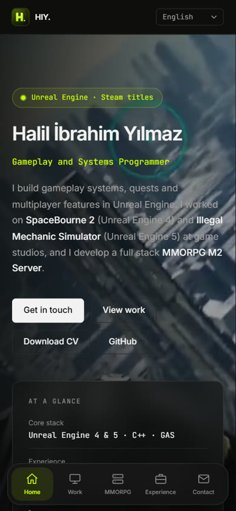
  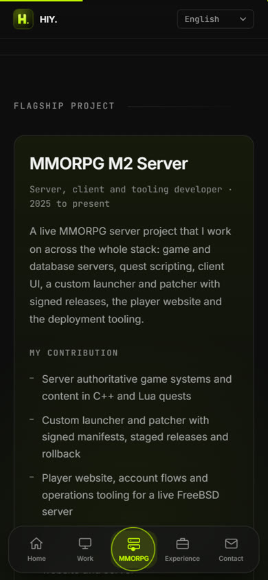
</p>

## CV (ATS friendly)

`Halil_Ibrahim_YILMAZ_CV.pdf` is generated from `cv/cv.html`.

| Rule | Why it matters |
| --- | --- |
| One column, no tables, text boxes, icons or images | Parsers read left to right and merge columns or drop table cells |
| Real, selectable text in Arial | Fonts and glyphs extract cleanly, nothing needs OCR |
| Contact details in the page body, not in a header or footer | Many parsers ignore margin zones |
| Standard headings: Professional Summary, Skills, Professional Experience, Projects, Education, Languages | Maps directly to ATS fields |
| Reverse chronological roles, each on one line with title, company and dates in the form "Mon YYYY - Mon YYYY" | Reliable extraction of titles, employers and dates |
| Engine, language and tool names inside achievement sentences, acronyms spelled out once (Gameplay Ability System (GAS), Amazon Web Services (AWS)) | Lexical and semantic matchers both score them |
| Titles worked on and engine keywords in the Experience section | Studio recruiters search by engine and title first |

Regenerate the PDF after editing `cv/cv.html` (any Chromium based browser, print to PDF with A4 and the page's own margins). Check it by selecting all text in the PDF and pasting it into a plain text editor: the reading order must stay top to bottom.

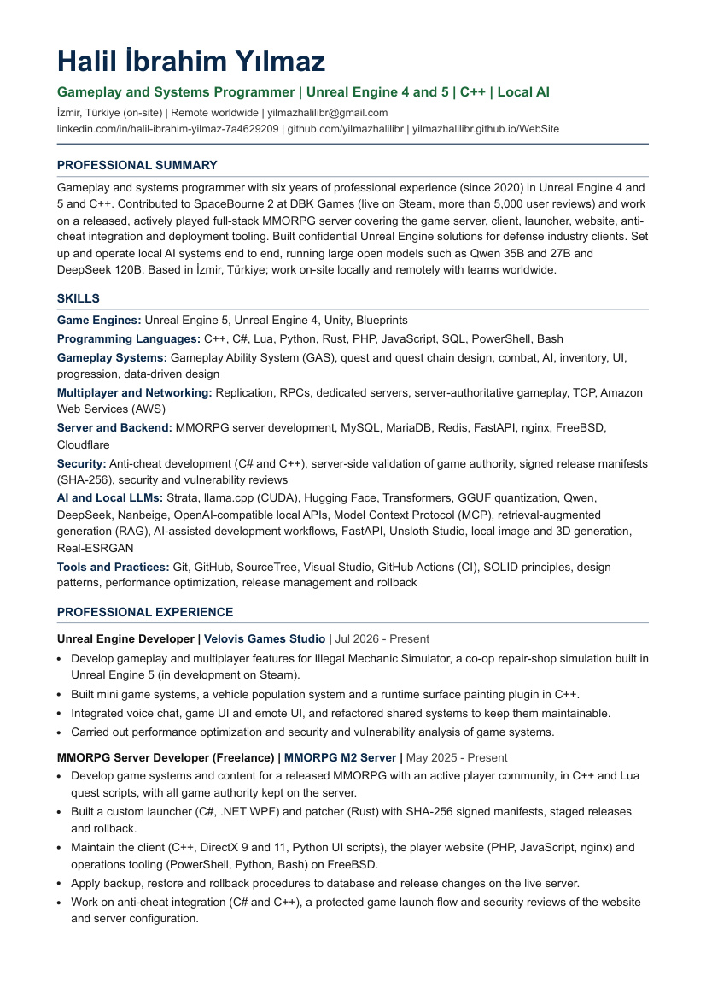

## Work shown on the site

Studio titles (SpaceBourne 2, Illegal Mechanic Simulator, MvsM, Terminal Toilet Simulator) are projects I worked on at studios, not projects I own. The MMORPG M2 Server is a project we run as a team and I work on across the whole stack. The personal projects are my own.

### SpaceBourne 2 | DBK Games (2023 to 2025)

Unreal Engine 4 game published by DBK Games on Steam in November 2025. Role: designed and built new quests and quest chains and fixed bugs across all game systems. Active contributor to the sequel, SpaceBourne 3 (in development).

[Store page](https://store.steampowered.com/app/1646850/SpaceBourne_2/)

| | | |
| --- | --- | --- |
| 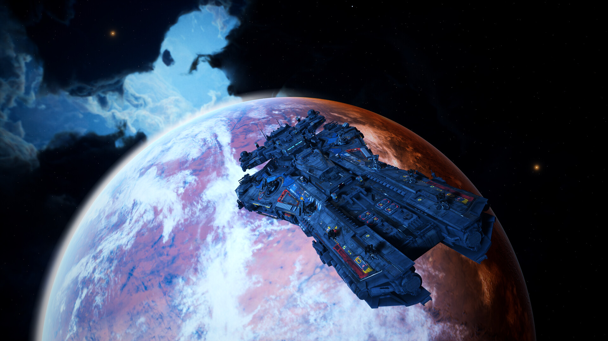 | 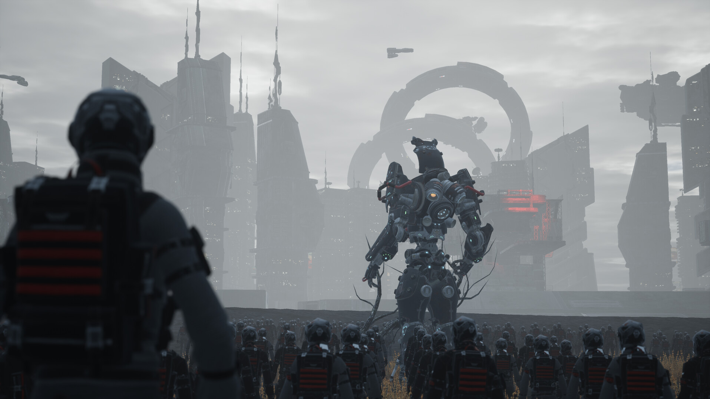 | 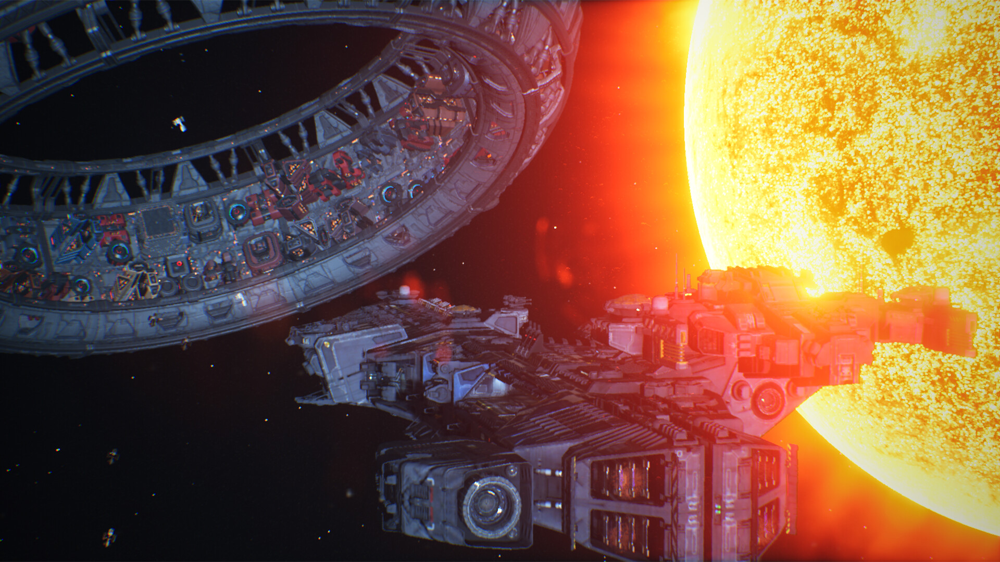 |

### Other Steam titles (in development)

| Illegal Mechanic Simulator | MvsM | Terminal Toilet Simulator |
| --- | --- | --- |
| 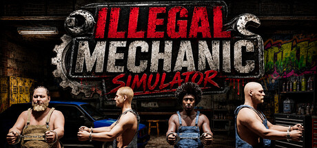 |  | 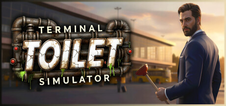 |
| Velovis Games Studio, Unreal Engine 5. Co-op repair shop simulation. | Mania Interactive. Cartoon co-op PvE for 1 to 8 players. | Mania Interactive. Absurdist restroom management sim. |
| [Steam](https://store.steampowered.com/app/4973030/Illegal_Mechanic_Simulator/) | [Steam](https://store.steampowered.com/app/1289320/MvsM/) | [Steam](https://store.steampowered.com/app/3314740/Terminal_Toilet_Simulator/) |

| | | |
| --- | --- | --- |
| 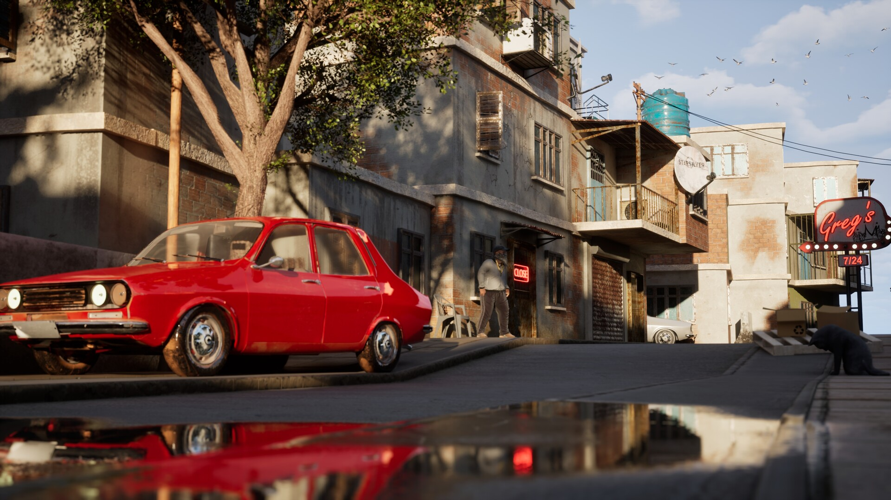 | 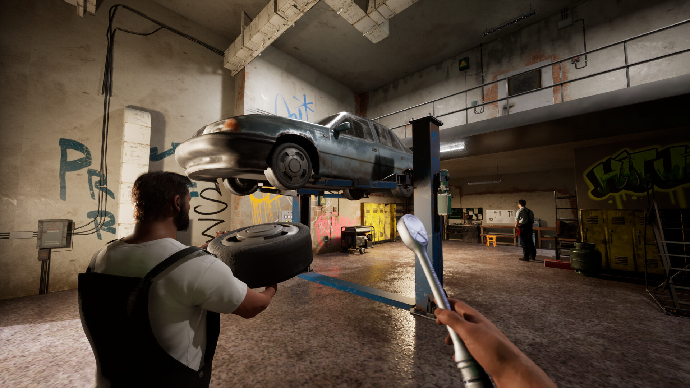 | 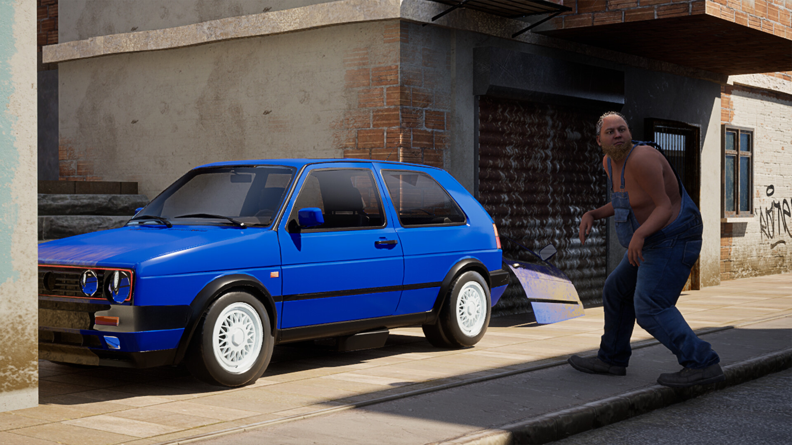 |

### Flagship project: MMORPG M2 Server (2025 to present)

A released MMORPG with an active player community. I work on it across the whole stack: game and database servers, quest scripting, client UI, a custom launcher and patcher with signed releases, the player website and the deployment tooling. Test access is shared on request: write to me and I send the links.

| Area | Technologies |
| --- | --- |
| Game server | C++, Lua quests, FreeBSD, MariaDB |
| Client | C++, DirectX 9/11, Python UI scripts |
| Launcher and patcher | C#, .NET WPF, Rust, SHA-256, Cloudflare R2 |
| Website | PHP, JavaScript, CSS, nginx, php-fpm |
| Tooling and operations | PowerShell, Python, Bash, Cloudflare, VDS |

### Local AI workstation

AI systems installed, tuned, served and used locally. Models run include Qwen 35B (Qwen3.6-35B-A3B, Q4_K_M, about 54 tokens per second with hybrid GPU and CPU offload in llama.cpp), Qwen 27B, Qwen3.8-Flash-Next and DeepSeek V4.1-Flash. Strata, an open-source local inference engine, runs with custom setups for the last two (the very large DeepSeek model is streamed from SSD), Nanbeige 4.2 3B is served through a custom Transformers and FastAPI server, and models are downloaded, converted and checksum-verified from Hugging Face.

| Area | Technologies |
| --- | --- |
| Language models | Qwen 35B (A3B), Qwen 27B, Qwen3.8 Flash Next, DeepSeek V4.1 Flash, Nanbeige 4.2 3B, Spark X2.5 4B |
| Serving | Strata, llama.cpp (CUDA) server, Unsloth Studio, Transformers with FastAPI, OpenAI-compatible local APIs |
| Model hubs | Hugging Face, GGUF repositories, Transformers, quantization formats (IQ2, Q4_K_M, Q8_0) |
| Agents and tools | OpenCode, MCP servers, RAG, Unreal Engine editor bridge, Blender MCP |
| Image and 3D | Image generation (Unsloth Studio), Hunyuan3D 2.1, TRELLIS.2, Real-ESRGAN |
| Practice | Tokens per second benchmarks, checksum-verified models, PowerShell and Python automation |

### Personal projects

| Project | What it is | Stack |
| --- | --- | --- |
| Mitdrahk (private) | First person RPG developed solo: server authoritative damage, replicated vitals, progression on the player state, data driven items | Unreal Engine 5.8, C++, Replication |
| Unreal AI Tooling (private) | Skills, editor bridge plugin, retrieval index and CI validation for AI assisted Unreal development | Python, C++, WebSocket, GitHub Actions |
| [Crunch](https://github.com/yilmazhalilibr/Crunch) | Multiplayer MOBA prototype with GAS abilities, shop, inventory and an AWS dedicated server | Unreal Engine 5.6, C++, GAS, AWS |
| [Action Roguelike](https://github.com/yilmazhalilibr/Unreal_ActionRoguelike) | Ability based combat, procedural challenge loops, data driven progression | Unreal Engine 5, C++, GAS, AI |
| [Fortnite-Style Builder](https://github.com/yilmazhalilibr/Unreal_Building) | Placement, editing and real time destruction | Unreal Engine 5, C++ |
| [Inventory System](https://github.com/yilmazhalilibr/Unreal_Inventory) | Modular inventory framework with UI integration | Unreal Engine 5, C++ |
| [Manufacturing System](https://github.com/yilmazhalilibr/Unreal_ManufactureRepo) | Resource pipelines and factory automation | Unreal Engine 5, C++ |
| [Design Patterns in C#](https://github.com/yilmazhalilibr/DesignPatterns) | SOLID and creational, structural, behavioral patterns | C# |

## Languages

| Code | Language | Code | Language |
| --- | --- | --- | --- |
| `en` | English (source, lives in `index.html`) | `pl` | Polski |
| `de` | Deutsch | `sv` | Svenska |
| `fr` | Français | `nl` | Nederlands |
| `es` | Español | `it` | Italiano |
| `pt` | Português (Portugal) | `tr` | Türkçe |

## Project structure

```
index.html            Markup, English copy (data-i18n keys), pre-paint language detection, SEO, JSON-LD
styles.css            Design tokens, layout, mobile tab bar, motion and cursor effects
script.js             Language switch, hero media playlist, scroll and pointer effects, tab bar, contact composer
lang/xx.js            One dictionary per language: (window.I18N = ...).xx = { key: 'text' }
cv/cv.html            Source of the ATS friendly CV
Halil_Ibrahim_YILMAZ_CV.pdf
assets/               Icon set, hero trailers (hd and sd) and poster, project images (1080p and 4k), README previews
manifest.webmanifest Web app manifest
```

## Run locally

No install needed. Any static server works:

```bash
python -m http.server 8765
# open http://localhost:8765/
```

Open `?lang=de` (or any code from the table above) to force a language.

## Customising

- **Edit English copy:** change the text of the element with the matching `data-i18n="key"` in `index.html`.
- **Edit a translation:** change the same key in `lang/<code>.js`. Every language file must contain exactly the keys used in `index.html` plus `title`, `desc`, `vid_play`, `vid_pause` and `f_err`.
- **Add a language:** create `lang/<code>.js` with all keys, add the code to `L` in the inline script in `<head>` and to `LANGS` in `script.js`, and add an `<option>` to `#lang-select`.
- **Add a project or job:** copy an existing `.case` or `.xp` block, give its text new `data-i18n` keys and add them to every `lang/*.js`.
- **Hero media:** the playlist is built in `script.js` (`list` and `shots`). Trailers live in `assets/`, stills in `assets/projects/`. Encode a trailer as a muted H.264 loop of a few MB:

  ```bash
  ffmpeg -ss 7 -t 27 -i source.mp4 -an -vf scale=960:-2 -c:v libx264 -crf 30 \
         -pix_fmt yuv420p -movflags +faststart assets/sb2-trailer.mp4
  ```
- **Colours and sizing:** CSS custom properties at the top of `styles.css` (`--accent`, `--bg`, `--w`).

## Performance, accessibility, privacy

- Hero media only runs on screens wider than 720 px without *reduced motion* or *data saver*, pauses off-screen and can be paused by the visitor. Videos use `preload="none"`.
- Semantic landmarks, one `h1`, visible focus rings, labelled language selector, `lang` attribute updated on switch, 44 px touch targets in the tab bar.
- Reveal on scroll is only applied when `IntersectionObserver` exists. Without JavaScript all content is visible.
- No analytics and no cookies. `localStorage` stores only a language the visitor chose explicitly.
- Fonts (Inter, JetBrains Mono) load from Google Fonts.

## Credits and rights

- Source code and copy of this site: © Halil İbrahim Yılmaz. Ask before reusing personal content (text, CV).
- SpaceBourne 2 and Illegal Mechanic Simulator trailers and screenshots belong to their owners (DBK Games, Velovis Games Studio, Steam). MvsM and Terminal Toilet Simulator artwork belongs to Mania Interactive. They are shown here only to document my own work on those titles.
